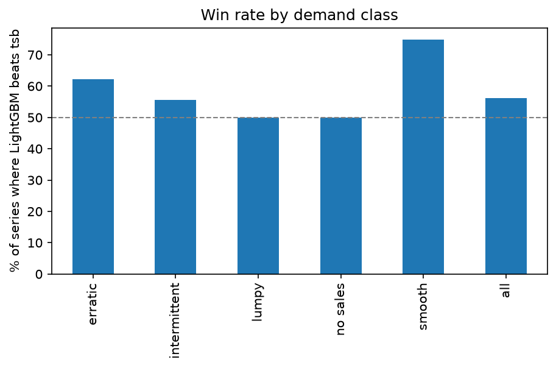
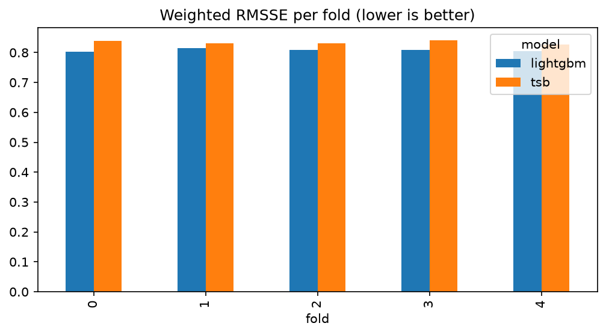
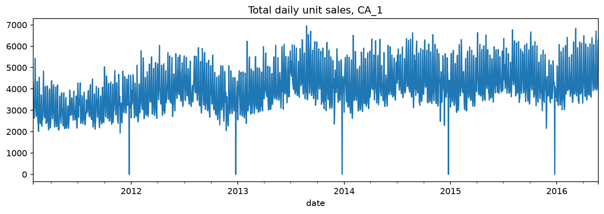
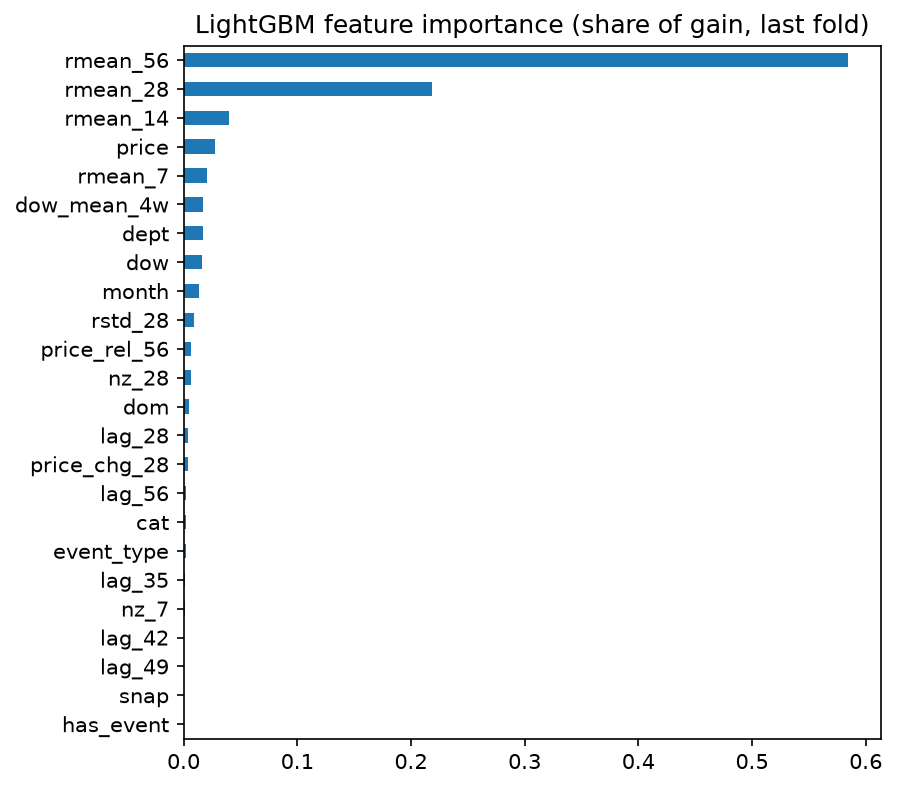

# M5 Demand Forecasting: Global LightGBM vs Intermittent-Demand Baselines

Forecasting 28-day daily unit sales for 3,049 Walmart products in one store (M5 dataset, store `CA_1`), and testing honestly whether a global LightGBM model beats classical baselines like TSB, moving averages, and weekday means.

**Short answer:** LightGBM beats the best baseline (TSB) on the revenue-weighted metric by 3.0%, but the gain is modest and not uniform. It wins on high-revenue, smoother items and does not beat TSB on intermittent and lumpy items or on store-level totals. Details below.



## Results

Backtest: 5 rolling-origin folds, each forecasting 28 days, ending at the last day of data. All numbers are averages over the 5 folds, lower is better except where noted.

| Model | Weighted RMSSE | Item-level WAPE | Bias | Store-level 28-day error |
|---|---|---|---|---|
| **LightGBM (global)** | **0.808** | 75.5% | -3.8% | 4.2% |
| TSB | 0.833 | 75.3% | -1.7% | 1.9% |
| Moving average (28d) | 0.835 | 75.5% | -3.6% | 3.7% |
| Weekday mean (last 4 weeks) | 0.868 | 77.4% | -3.6% | 3.7% |

The weekday mean and the 28-day moving average have identical store-level numbers by construction: both average the same last 28 days, so their 28-day totals match. The full list of 7 baselines (including naive and seasonal naive) is in `notebooks/02_baselines.ipynb`.

### By demand class

Series are classified with the Syntetos-Boylan scheme (ADI and CV2). Mean RMSSE per series, plus how often LightGBM beats TSB (the best baseline).

| Class | Series | LightGBM | TSB | Best | LightGBM win rate | Revenue-weighted |
|---|---|---|---|---|---|---|
| Smooth | 239 | **0.727** | 0.756 | LightGBM | 75% | 79% |
| Erratic | 82 | **0.627** | 0.635 | LightGBM | 62% | 67% |
| Intermittent | 2,192 | 0.721 | **0.713** | TSB | 56% | 66% |
| Lumpy | 534 | 0.679 | **0.666** | TSB | 50% | 57% |
| All | 3,049 | 0.808* | 0.833* | | 56% | 68% |

*Revenue-weighted score from the table above. Two series with no sales are in the total but not shown separately.

### What I take from this

1. **A modest, real gain where the revenue is.** LightGBM beats TSB on 56% of series, but 68% when weighted by revenue, so its wins are concentrated in the items that matter most.
2. **Not a clear win at every level.** Item-level WAPE is about the same (75.5% vs 75.3%), and the 28-day store total is off by 4.2% on average versus 1.9% for TSB. A planner who only needs store totals would be fine with TSB.
3. **Everyone under-forecasts.** Bias is negative for all models, and LightGBM has the largest (-3.8%). A possible reason is rising demand in the test window, but I have not verified that.
4. **The model is mostly a smoothed level.** The top features are the 56-, 28- and 14-day rolling means, then price and the 7-day mean. Calendar, event and SNAP features add almost nothing in the final fold. Because every feature must be at least 28 days old (direct 28-day forecasting), the model cannot see recent days.
5. **Weekday patterns are strong in aggregate but hard to use per item.** Weekends sell about 1.26x an average day, yet the weekday-mean baseline was the weakest. Per-item weekday patterns are probably too noisy to estimate from 4 weeks.
6. **Most of the problem is intermittent demand.** About 72% of series are intermittent and 17.5% lumpy, which is why methods built for sparse demand (TSB) are hard to beat.



## Data

[M5 Forecasting - Accuracy](https://www.kaggle.com/competitions/m5-forecasting-accuracy) (Walmart, Kaggle). I use store `CA_1`: 3,049 items, 1,941 days (2011-01-29 to 2016-05-22), with calendar events, SNAP days, and weekly sell prices. Raw data is not included in this repo (Kaggle terms); `scripts/download_data.py` fetches it.

EDA highlights (`notebooks/01_eda.ipynb`):
- Total daily sales trend upward over the period, with one drop to near zero each year around year-end.
- Day-of-week pattern: Saturday and Sunday are about 1.26x an average day, Tuesday to Thursday about 0.84x.
- Demand classes: 71.9% intermittent, 17.5% lumpy, 7.8% smooth, 2.7% erratic.



## Method

**Evaluation**
- 5 rolling-origin folds, 28 days each, origins 28 days apart, ending at the last day of data.
- **RMSSE** per series (the M5 metric): error scaled by the series' in-sample one-step naive error, so items of different sizes are comparable.
- **Weighted RMSSE**: series weighted by revenue in the 28 days before each forecast origin. This is item-store level only, so it approximates, but does not reproduce, the official 12-level WRMSSE.
- **WAPE** (total absolute error / total actual units), **bias**, and **store-level error** (28-day total forecast vs actual).

**Baselines** (`notebooks/02_baselines.ipynb`): naive, seasonal naive (7d), moving averages (7d, 28d), weekday mean (last 4 weeks), Croston, TSB. All vectorized across series.

**LightGBM** (`notebooks/03_lightgbm.ipynb`)
- One global model for all series, retrained on each fold using only days before the forecast origin (540 training days).
- Direct 28-day forecasting: all sales features are at least 28 days old, so one model forecasts the whole horizon with no leakage.
- Features: lags (28 to 56 days), rolling means (7, 14, 28, 56), rolling std, share of non-zero days, weekday mean, day of week / month / day of month, events, SNAP, price, price relative to its 56-day average, 28-day price change, category and department.
- Tweedie objective (variance power 1.1) for count data with many zeros. Rows where the item was not yet on sale are excluded from training and forecast as 0.

**Error analysis** (`notebooks/04_evaluation.ipynb`): headline table, store-level view, per-fold stability, win rate by class, error concentration, bias by class.



## Limitations

- One store only. Results may differ for other stores.
- Item-store level evaluation only, no hierarchical aggregation or reconciliation.
- No hyperparameter tuning beyond sensible defaults.
- The official WRMSSE is not reproduced.
- Item-level WAPE is high (around 75%) for every model because most series are sparse daily counts.

## Next steps

These are ideas, not results:
- Combine the two: use TSB for intermittent and lumpy series and LightGBM for smooth and erratic ones, or average the two forecasts.
- Add longer windows (91, 182, 364 days) and a trend or bias correction, since all models under-forecast.
- Tune the Tweedie power, leaves, rounds, and training window length.
- Extend to all 10 stores and add hierarchical reconciliation.

## Reproduce

```bash
pip install -r requirements.txt
python scripts/download_data.py      # needs a Kaggle API token and accepted competition rules
jupyter lab                          # run notebooks 01 to 04 in order
python -m pytest -q                  # unit tests for metrics, backtest splits, features
```

## Repo structure

```
data/raw, data/processed   not committed
notebooks/                 01 EDA, 02 baselines, 03 LightGBM, 04 evaluation
src/                       data loading, features, metrics, backtesting
scripts/download_data.py   Kaggle download
tests/                     unit tests
reports/                   result tables and figures
```

## Author

Ahmed Hamdi Hegazi | [GitHub](https://github.com/AHAH000) | [Portfolio](https://ahah000.github.io)
